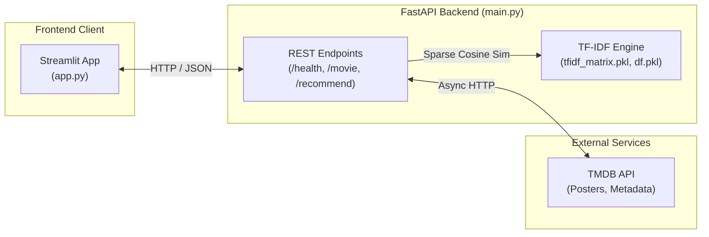

# 🎬 Movie Recommendation System (Content-Based)

A production-ready content-based movie recommendation system built with **Python**, **Scikit-Learn (TF-IDF + Cosine Similarity)**, **FastAPI (REST API)**, and **Streamlit (Interactive UI)** with **TMDB (The Movie Database)** API integration for posters, trailers, and live metadata.

---

## 🌟 Features

- **Content-Based Filtering**: TF-IDF vectorization with unigrams + bigrams and cosine similarity matching on combined movie overviews, genres, and taglines.
- **Interactive Web Interface**: Streamlit application featuring:
  - Instant movie search with autocomplete suggestions.
  - Category feeds (Trending, Popular, Top Rated, Now Playing, Upcoming).
  - Detailed movie view (backdrop, poster, release date, genres, overview).
  - Dual recommendation shelves: **TF-IDF Similar Content** and **TMDB Genre Discovery**.
- **Production REST API**: FastAPI backend with OpenAPI Swagger documentation (`/docs`), automated health checks (`/health`), and CORS enabled.
- **Graceful Fallbacks**: Resilient against cold starts, sleeping cloud instances (Render), and missing API keys.
- **Deployment Ready**: Fully configured for **Streamlit Community Cloud**, **Render**, **Railway**, **Heroku**, and **Docker**.

---

## 🏗️ Architecture



---

## 📂 Project Structure

```text
├── app.py                  # Streamlit web application
├── main.py                 # FastAPI production REST API
├── train.py                # Standalone model training & artifact pipeline
├── movies.ipynb            # Jupyter exploratory data analysis & training notebook
├── df.pkl                  # Serialized movie metadata DataFrame
├── indices.pkl             # Serialized title-to-index lookup mapping
├── tfidf.pkl               # Fitted Scikit-Learn TfidfVectorizer
├── tfidf_matrix.pkl        # Sparse TF-IDF matrix
├── requirements.txt        # Pinned Python package dependencies
├── runtime.txt             # Cloud runtime specification (Python 3.11.9)
├── .python-version         # Version manager specification
├── Dockerfile              # Containerization definition
├── Procfile                # Process file for Heroku/Render
├── render.yaml             # Render Infrastructure-as-Code Blueprint
├── .dockerignore           # Excluded files for fast Docker builds
├── .gitignore              # Git ignore rules
├── .env.example            # Environment variables template
└── .streamlit/
    └── config.toml         # Custom Streamlit UI styling and server config
```

---

## 🚀 Quick Start (Local Development)

### 1. Clone & Set Up Virtual Environment

```bash
git clone https://github.com/rhRohitHalder/Movie-Recommendation-System---ML.git
cd "Movie-Recommendation-System---ML"

# Create a virtual environment with Python 3.11 or 3.12
python -m venv venv

# Activate on Windows:
venv\Scripts\activate
# Activate on Linux/macOS:
source venv/bin/activate

# Install dependencies
pip install -r requirements.txt
```

### 2. Configure Environment Variables

Create a `.env` file in the project root:

```bash
# Copy template
cp .env.example .env
```

Edit `.env`:
```env
# Get a free API key at https://www.themoviedb.org/settings/api
TMDB_API_KEY=your_tmdb_api_key_here
API_BASE=http://127.0.0.1:8000
PORT=8000
```

### 3. Run the Backend API (FastAPI)

```bash
uvicorn main:app --reload --port 8000
```
- **API URL**: `http://127.0.0.1:8000`
- **Interactive Swagger Docs**: `http://127.0.0.1:8000/docs`
- **Health Check**: `http://127.0.0.1:8000/health`

### 4. Run the Frontend (Streamlit)

In a new terminal window (with virtual environment activated):

```bash
streamlit run app.py
```
- **Web App**: `http://localhost:8501`

---

## 📡 REST API Endpoints

| Method | Endpoint | Description |
|---|---|---|
| `GET` | `/` | API status and links |
| `GET` | `/health` | Health probe (service status, model readiness, TMDB status) |
| `GET` | `/home?category={category}&limit={n}` | Category feed (trending, popular, top_rated, upcoming) |
| `GET` | `/tmdb/search?query={title}` | TMDB keyword search with multi-result matching |
| `GET` | `/movie/id/{tmdb_id}` | Detailed movie metadata (poster, backdrop, genres, overview) |
| `GET` | `/movie/search?query={title}` | All-in-one search bundle: Details + TF-IDF Recs + Genre Recs |
| `GET` | `/recommend/tfidf?title={title}&top_n={n}` | Pure TF-IDF cosine similarity recommendations |
| `GET` | `/recommend/genre?tmdb_id={id}&limit={n}` | Genre-based discovery recommendations |

---

## ☁️ Deployment Guide

### Option 1: Deploy on Render (Recommended Blueprint)

1. Push your repository to GitHub.
2. Sign in to [Render](https://render.com).
3. Click **New +** → **Blueprint**.
4. Select your GitHub repository.
5. Render reads `render.yaml` and will set up:
   - `movie-rec-api` (FastAPI backend service)
   - `movie-rec-frontend` (Streamlit web application)
6. Add your `TMDB_API_KEY` in the environment variables settings on the Render dashboard.

---

### Option 2: Deploy Frontend on Streamlit Community Cloud (Free)

1. Deploy the backend API to Render or Railway to get an API URL (e.g., `https://your-api.onrender.com`).
2. Go to [share.streamlit.io](https://share.streamlit.io).
3. Connect your GitHub repository.
4. Set:
   - **Main file path**: `app.py`
   - **Python version**: `3.11`
5. In **Advanced Settings** → **Secrets**, add:
   ```toml
   API_BASE = "https://your-api.onrender.com"
   ```
6. Click **Deploy**!

---

### Option 3: Deploy with Docker

Build and run the container locally or on any cloud provider (AWS ECS, Google Cloud Run, Railway):

```bash
# Build the Docker image
docker build -t movie-recommender .

# Run the FastAPI backend container
docker run -d -p 8000:8000 -e TMDB_API_KEY=your_key --name movie-api movie-recommender

# Run Streamlit frontend container
docker run -d -p 8501:8501 -e API_BASE=http://host.docker.internal:8000 --name movie-ui movie-recommender streamlit run app.py --server.port 8501 --server.address 0.0.0.0
```

---

## 🔄 Retraining Model Artifacts

To regenerate `df.pkl`, `indices.pkl`, `tfidf.pkl`, and `tfidf_matrix.pkl` from `movies_metadata.csv`:

```bash
python train.py
```

---

## 🔑 Getting a Free TMDB API Key

1. Create a free account at [The Movie Database (TMDB)](https://www.themoviedb.org/signup).
2. Go to **Settings** → **API** (`https://www.themoviedb.org/settings/api`).
3. Click **Create** → **Developer**.
4. Accept the terms and fill in basic details.
5. Copy your **API Key (v3 auth)** into your `.env` or cloud provider environment settings.
